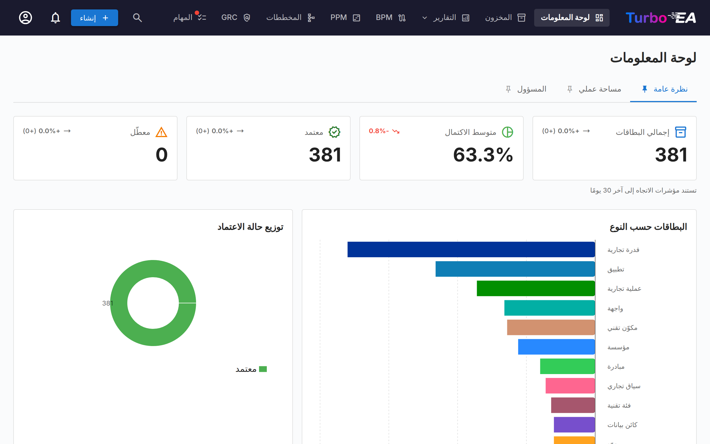
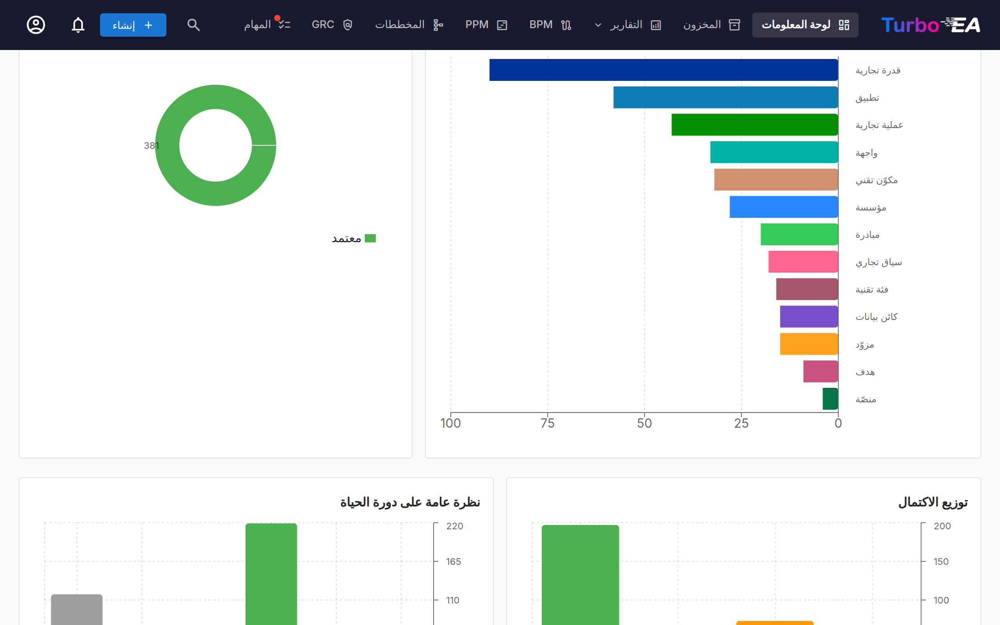

# لوحة المعلومات

لوحة المعلومات هي أول شاشة تراها بعد تسجيل الدخول. وهي توفّر **نظرة عامة سريعة** على حالة هندسة المؤسسة بأكملها.

## شريط التنقّل العلوي

في أعلى الشاشة، ستجد **شريط التنقّل الرئيسي** مع العناصر التالية:

- **Turbo EA** (الشعار): انقر للعودة إلى لوحة المعلومات من أي قسم
- **لوحة المعلومات**: نظرة عامة على حالة الهندسة
- **المخزون**: قائمة كاملة بجميع البطاقات
- **التقارير**: تقارير مرئية وتحليلية
- **BPM**: إدارة عمليات الأعمال (إذا كانت مفعّلة)
- **المخططات**: محرّر مخططات الهندسة المرئي
- **تسليم هندسة المؤسسة**: إدارة مبادرات الهندسة
- **المهام**: المهام المعلّقة والاستبيانات المُسنَدة
- **بحث البطاقات**: شريط بحث سريع مع الإكمال التلقائي
- **+ إنشاء**: زر لإنشاء بطاقات جديدة بسرعة
- **جرس الإشعارات**: تنبيهات النظام و[الإشعارات](notifications.md)
- **أيقونة الملف الشخصي**: اختيار اللغة، وتبديل السمة، وتفضيلات الإشعارات، والوصول إلى الإدارة
- **ادعم**: زر بلون أرجواني وردي بجوار رقم الإصدار في قائمة الملف الشخصي يفتح نافذة توضح أهمية الرعاية، مع رابط للمدونة وخيارات لمرة واحدة أو شهرية عبر GitHub Sponsors

## بطاقات الملخّص

يعرض القسم الرئيسي من لوحة المعلومات **بطاقات ملخّص** تشير إلى:

- **إجمالي عدد البطاقات**: عدد جميع المكوّنات المسجَّلة في المنصة
- **التوزيع بحسب النوع**: عدد العناصر من كل نوع (التطبيقات، المنظمات، الأهداف، القدرات، إلخ)
- **نظرة عامة على الحالة**: تصورات سريعة للحالة الإجمالية

يؤدّي النقر على بطاقة نوع إلى الانتقال إلى [المخزون](inventory.md) مع تصفية مسبقة على ذلك النوع.

## المخططات والإحصاءات

في القسم السفلي من لوحة المعلومات ستجد:

- **مخطط التوزيع بحسب النوع**: يعرض نسبة كل نوع بطاقة في مشهدك
- **حالة الموافقة**: يشير إلى عدد البطاقات المُعتمدة أو المعلّقة أو المكسورة أو المرفوضة
- **جودة البيانات**: النسبة المئوية الإجمالية لاكتمال المعلومات عبر جميع البطاقات
- **النشاط الأخير**: موجز بأحدث التغييرات — من حرّر ماذا ومتى

## علامة تبويب التنفيذي

علامة تبويب **التنفيذي** ملخّص في صفحة واحدة للتنفيذ والمال والمخاطر موجّه للإدارة العليا. تظهر للأدوار التي تملك إذن **`reports.executive_dashboard`** — يملكه المسؤولون تلقائيًا، ويمكن منحه لأي دور آخر من **الإدارة ← المستخدمون والأدوار**. كل رقم يحتسب البطاقات المسموح لك برؤيتها فقط، وتُستبعد أنواع البطاقات التي أخفاها المسؤول من كل إجمالي.

تضم علامة التبويب خمس صفحات: **نظرة عامة** و**الاستراتيجية** و**الحوكمة** و**القرارات** و**التفاصيل**.

**نظرة عامة** هي عرض الرئيس التنفيذي: ستة مؤشرات — تحقيق الاستراتيجية، وفاعلية حوكمة البنية المؤسسية، وتنفيذ المبادرات، والخدمات والأتمتة، والقيمة للأعمال، والقرارات والتصعيدات — لكل منها بطاقة تعرض القيمة والمستهدف والفترة السابقة وفترة التقرير وحداثة البيانات والمالك وتسمية للثقة ورابطًا إلى السجلات التي يستند إليها. يختار محدِّد **فترة التقرير** سنة مالية أو أحد أرباعها. ويُحفظ الاختيار في عنوان الصفحة، فيفتح إعادة التحميل أو الرابط المشترك الفترة نفسها، وينتقل بين الصفحات التنفيذية (تستخدم صفحة التفاصيل سنتها المالية)؛ وأثناء تحميل فترة جديدة لا يبقى على الشاشة أي رقم من الفترة السابقة. ويُقاس الرقم حتى آخر يوم في الفترة (أو حتى اليوم للفترة الحالية). المؤشر الذي لم يُحدَّد مصدره أو قاعدته بعد يظهر **غير متاح** مع السبب، ولا يظهر صفرًا أبدًا: وهذا ينطبق حاليًا على فاعلية الحوكمة والخدمات والأتمتة والقيمة المتحققة للأعمال، وعلى تحقيق الاستراتيجية إلى أن تكون للمؤشرات الاستراتيجية مستهدفات معتمدة وقياسات موثَّقة. تظهر الوفورات المخططة على بطاقة القيمة للأعمال بوصفها **توقّعًا** فقط. يأتي مستهدف المؤشر ومالكه من بطاقة مؤشر الأداء المرتبطة به (انظر *بطاقات مؤشرات الأداء: الأداء والمستهدف* أدناه)؛ وإلى أن تُربط بطاقة يظهران بعبارتي **لا يوجد مستهدف معتمد بعد** و**لم يُحدَّد بعد**. ولا تُقارن القيمة بالمستهدف إلا بعد أن يكون المستهدف **معتمدًا** واتجاه المؤشر محددًا. يُعرض تنفيذ المبادرات للفترة الحالية فقط، وبجانبه **تغطية التقارير** مع تنبيه حين لا تقدّم مبادرات جارية تقاريرها أو حين لا يكون حدّ تقادم التقارير مضبوطًا. وللفترة المنتهية، وللمقارنة بالفترة السابقة، تُعرض قيمة الفترة **الموثَّقة** من سجل قياسات المؤشرات؛ فإن لم توجد تظهر عبارة **البيانات التاريخية غير متاحة** (أو *بانتظار التوثيق* إذا سُجّلت قيمة لم تُوثَّق بعد) — ولا يُعاد احتساب أي رقم من مبادرات اليوم. وهذه القيم التاريخية تخص المشهد بأكمله، لذا لا تُعرض إلا لمن يستطيع رؤية كل البطاقات. أما البطاقات الموسومة **الوضع الحالي** — القرارات والتصعيدات، وتوقّع الوفورات المخططة — فتُظهر الوضع اليوم أيًّا كانت الفترة المختارة، ولا تُعدّ أبدًا نتائج لفترة سابقة. وتظهر المؤشرات الأخرى عبارة *لا يوجد سجل بعد*. وتسرد لوحة **التصعيدات للإدارة العليا** المخاطر التي تستوفي معايير التصعيد المعتمدة فقط، وإن لم تكن لديك صلاحية فتح سجل المخاطر فإنها تعرض عددها بدلًا من لوحة فارغة. وعلى الهاتف تظهر هذه اللوحة أولًا فوق المؤشرات. والمؤشر غير المتاح يوضّح بعبارات بسيطة ما يلزم الاتفاق عليه أو تأكيده قبل عرضه.

**الاستراتيجية** تعرض تحقيق الاستراتيجية للفترة الحالية. *المؤشر الاستراتيجي* بطاقة مؤشر أداء نشطة تعريفها معتمد، ومرتبطة بهدف نشط نوعه *استراتيجي*. والرقم الرئيسي هو **X من Y مقيسة تحقق المستهدف** — ويحقق المؤشر مستهدفه حين يبلغ قياسه الموثَّق للفترة مستهدفه المعتمد في اتجاه المؤشر — وبجانبه التغطية (المؤشرات المقيسة من المؤشرات المرتبطة). وتسرد الركائز والأهداف الاستراتيجية مؤشراتها مع القيمة الفعلية والمستهدف ونسبة الإنجاز ((الفعلي − خط الأساس) ÷ (المستهدف − خط الأساس)، من 0 إلى 100٪، لكل مؤشر على حدة) وحالة: **يحقق المستهدف** أو **دون المستهدف** أو **لا توجد قيمة موثَّقة** أو **المستهدف غير معتمد** أو **الاتجاه غير محدد** أو **التعريف غير معتمد**. لا توجد أوزان ولا مؤشر مركّب، ولا يُستخدم التقدم المُبلَّغ ذاتيًا للأهداف. ويُعرض **تنفيذ الاستراتيجية** — حالة تنفيذ المبادرات الداعمة للأهداف الاستراتيجية — منفصلًا، لأن التنفيذ ليس دليلًا على تحقيق الهدف. وتظهر الفترة المنتهية بعبارة *البيانات التاريخية غير متاحة*، لأن الروابط بين الأهداف والمؤشرات لا تحتفظ بسجل تاريخي.

**الحوكمة** تعرض حوكمة البنية المؤسسية في ثلاثة أقسام تبقى منفصلة تمامًا. **النشاط** يسجّل ما جرى من الحوكمة في هذه الفترة — القرارات الموقَّعة، والمراجعات المعمارية المقرَّرة، واستثناءات المعايير بحالتها الراهنة — أعدادًا فقط دون أي ادعاء بالأداء؛ وتُحسب المراجعات المعمارية بتاريخ آخر قرار، وتُعرض المؤجَّلة على حدة ولا تُعدّ قرارات أبدًا. **الفعالية** تعرض **الامتثال لمعايير التقنية** (النسبة القائمة على القواعد للتطبيقات ومكوّنات تقنية المعلومات المُقيَّمة التي لا تستخدم معيارًا في طور الإيقاف أو محظورًا دون إعفاء ساري — والإعفاء المنتهي يُعدّ مخالفة)، وبجانبها رقمًا منفصلًا هو **تغطية التقييم** (ما نسبته من المجتمع المؤهَّل جرى تقييمه)؛ ولا يُدمج الرقمان أبدًا، وغياب المخالفات المكتشفة لا يُوصف بأنه امتثال كامل. وإذا كنت تملك إذن المعايير التقنية تُسرد السجلات وراء فجوة الامتثال أسفل الرقم. ويظهر الامتثال **غير متاح** مع سببه حين لا يشير أي معيار إلى فئة، أو حين لا تستطيع رؤية التطبيقات أو مكوّنات تقنية المعلومات أو الفئات التقنية، أو حين لا يقع شيء ضمن معيار محكوم. **الأثر** يضم التسليم المحكوم مقابل غير المحكوم، ومخاطر البنية، والقيمة الأعمالية للحوكمة؛ ويظهر كلٌّ منها **غير متاح** مع السبب البسيط الذي يحتاجه، لأنها تعتمد على تحديثات لاحقة. والبطاقة التي لا يحق لك رؤيتها لا تغيّر أي عدّ في هذه الصفحة. ويُسجَّل رقم الامتثال يوميًا في سجل قياسات المؤشرات، فيمكن ربط بطاقة مؤشر أداء به (انظر *بطاقات مؤشرات الأداء: الأداء والمستهدف* أدناه).

**القرارات** تعرض الوضع الحالي في مجموعتين منفصلتين. **التصعيدات للإدارة العليا** هي المخاطر المفتوحة التي تستوفي القاعدة المعتمدة — ذات المستوى الحرج، أو العالي وقد تجاوزت تاريخها المستهدف (ولا يكفي تصنيف الخطر استراتيجيًا لتصعيده) — مع احتساب المخاطر المفتوحة والمخففة كلٌّ على حدة. أما **مسار الحوكمة التشغيلية** فيضم أنشطة الحوكمة الاعتيادية: سجلات القرارات المعمارية بانتظار التوقيع، والمراجعات المعمارية المجدولة أو المؤجلة، والاستثناءات المطلوبة من المعايير. ويُعرض للاطلاع وليس تصعيدًا. يرى كل من يملك علامة التبويب التنفيذي الأعداد، أما رؤية السجلات نفسها فتتطلب صلاحية العرض الخاصة بكل وحدة (المخاطر، وسجلات القرار، والمراجعات المعمارية، والمعايير التقنية).

**التفاصيل** تضم الأرقام الموضحة أدناه.

يعرض رأس الصفحة وقت إنشاء الأرقام، وتاريخ آخر تقرير حالة للمبادرات، ومحدِّد **فترة التقرير** الذي يختار السنة المالية لأرقام الميزانية (تتبع السنة المالية إعداد **الإدارة ← الإعدادات ← بداية السنة المالية**).

**الأرقام الرئيسية.** لكل بطاقة رمز معلومات يشرح الرقم بلغة واضحة، ورابط إلى الصفحة التي يستند إليها، وتسمية توضّح مصدره: **مسجّل** (محسوب من السجلات في Turbo EA)، أو **مُبلَّغ ذاتيًا** (من تقارير الحالة)، أو **توقّع** (تقدير مخطط له)، أو **مقيّد** (لا تملك الصلاحية)، أو **غير متاح** (لا يوجد ما يسجّله بعد). لا يوجد في علامة التبويب أي رقم متحقَّق منه ماليًا.

- **المبادرات على المسار**: من بين المبادرات الجارية التي لديها تقرير حالة ساري، نسبة تلك التي يكون آخر تقرير لها على المسار في الجدول الزمني والتكلفة والنطاق (يحدّد الأسوأ بينها الحالة).
- **تغطية التقارير**: عدد المبادرات الجارية التي لديها تقرير حالة ساري. تُعرض منفصلة حتى لا يختفي غياب التقارير داخل رقم السلامة.
- **تنفيذ الميزانية**: التكلفة الفعلية المسجلة في السنة المالية المختارة مقسومة على الميزانية المخططة لتلك السنة.
- **المخاطر الحرجة والعالية المفتوحة**، مع عدد المتأخر منها.
- **الوفورات المخططة**: التوقّع المستمد من قرارات الترشيد (انظر أدناه).

**التنفيذ.** كل مبادرة جارية إما **على المسار** أو **معرّضة للخطر** أو **خارج المسار** أو **غير معروفة / لم يُبلَّغ**. المبادرة التي ليس لها تقرير حالة تكون *غير معروفة / لم يُبلَّغ* — لا تُحتسب أبدًا كسليمة ولا كمعرّضة للخطر. المبادرات المكتملة والمعلّقة ليست جارية وتُذكر بشكل منفصل. يمكن للمسؤول تحديد **حدّ للتقادم** (**الإدارة ← الإعدادات ← تقادم تقارير المبادرات**)؛ وعندها تُعدّ التقارير الأقدم منه غير مُبلَّغ عنها أيضًا. لا توجد قيمة افتراضية: إلى أن يُحدَّد، يُحتسب كل تقرير موجود وتذكر علامة التبويب ذلك. عند تعطيل وحدة إدارة المحافظ والمشاريع (PPM) يُستخدم حقل **الحالة** الخاص بكل مبادرة بدلًا من تقارير الحالة. الميزانية والفعلي للسنة المالية المختارة فقط — لا تُجمع السنوات أبدًا، وبند التكلفة الذي ليس له تاريخ لا ينتمي إلى أي سنة (وتذكر علامة التبويب عددها).

**الوفورات المخططة.** تُحتسب الوفورات المخططة في قرارات الترشيد (التقييمات النشطة والمكتملة) **مرة واحدة لكل تطبيق**: إذا أعطى تقييمان التقدير نفسه يُحتسب مرة واحدة. وإذا اختلفت التقديرات يُعدّ التطبيق **تعارضًا**: يُستبعد من الإجمالي إلى أن تتم مطابقة التقديرات، وتسرده علامة التبويب مع كل تقديراته. تذكر القائمة أسماء التطبيقات والتقييمات، لذا تتطلب أيضًا إذن **`rationalization.view`**؛ ومن دونه ترى عدد التعارضات فقط. الوفورات المخططة دائمًا **توقّع**؛ وتُعرض **الوفورات المتحققة** منفصلة بوصفها *غير متاحة* إلى أن تُسجَّل منافع متحقَّق منها. لم تُربط الوفورات المخططة بسنة مالية بعد، لأن القرارات لا تحمل فترة مالية.

**التعرض للمخاطر** يعرض المخاطر المفتوحة حسب المستوى، و**العمليات** يعرض مستوى الأتمتة والنضج، مع تغطية توثيق العمليات (العمليات التي لها مخطط منشور) في سطر منفصل — فالتوثيق ليس أتمتة ولا نضجًا.

**مقاييس المستودع (متخصصة)** قسم مطويّ يضم أعداد البطاقات، و**اكتمال البيانات** (نسبة الحقول الموزونة المعبأة، وليس مقياسًا للصحة)، و**حالة المراجعة في المستودع** (هل رُوجعت البطاقات — وليست امتثالًا معماريًا)، وأكبر أنواع البطاقات وتوزيع دورة الحياة، حيث تظهر شريحة نهاية العمر باسم **تجاوزت نهاية العمر المخطط لها**.

**المال والصلاحيات.** تتطلب أرقام الميزانية والإنفاق الفعلي والوفورات المخططة إذن **`costs.view`**؛ ومن دونه تظهر كلمة **مقيّد** بدلًا من الرقم. تُعرض المبالغ بالعملة المحددة في **الإدارة ← الإعدادات ← العملة**، وهي العملة التي سُجّلت بها: لا يُحوَّل أي مبلغ، ولا تُجمع أبدًا مبالغ بعملات مختلفة. والقسم الذي تكون وحدته معطّلة يشير إلى ذلك بدلًا من عرض أصفار.

### بطاقات مؤشرات الأداء: الأداء والمستهدف

لكل بطاقة مؤشر أداء قسم **الأداء والمستهدف** في صفحة تفاصيلها.

- **المستهدف.** تأتي قيمة المستهدف وتاريخه وخط الأساس والوحدة والاتجاه من حقول البطاقة نفسها. ويبقى المستهدف **غير معتمد** إلى أن يعتمده المخوَّل باعتماد المستهدفات عبر **اعتماد المستهدف**. وأي تغيير لاحق على المستهدف أو تاريخه أو خط الأساس أو الوحدة أو الاتجاه يجعله غير معتمد من جديد، مع بقاء الاعتماد السابق في السجل.
- **القياسات.** يحفظ **تسجيل قياس** قيمة لسنة مالية (`FY2026`) أو ربع (`FY2026-Q3`) قد بدأ، مع دليل اختياري. للفترة قيمة حالية واحدة؛ وتُدخل القيمة المختلفة عبر **تصحيح**، الذي يتطلب سببًا ويحتفظ بالقيمة السابقة بحالة **مُستبدَل**. وتبقى القيمة الجديدة أو المصحَّحة **بانتظار التوثيق** إلى أن يوثّقها شخص آخر — فلا يستطيع أحد توثيق قيمة سجّلها بنفسه. والقيمة الموثَّقة لفترة انتهت تصبح **مُجمَّدة**: يمكن تصحيحها، ولكن فقط بإدخال جديد خاضع للتدقيق. ويظهر كل حدث قياس في علامة تبويب **السجل** الخاصة بالبطاقة.
- **ربط المؤشر التنفيذي.** يربط حقل **المؤشر التنفيذي** بطاقة مؤشر الأداء بمؤشر تنفيذي محسوب (تنفيذ المبادرات TR-03، أو التصعيدات للإدارة العليا DEC-01، أو الامتثال لمعايير التقنية GOV-03)، فتعرض بطاقة النظرة العامة أو الحوكمة مستهدف تلك البطاقة وحالة اعتماده ومالكه (أصحاب المصلحة بدور *المسؤول* في البطاقة). ولا يمكن ربط أكثر من بطاقة مؤشر نشطة واحدة بكل مؤشر، ويتطلب تعيين الربط أو تغييره إذن **`admin.metamodel`**. والبطاقة التنفيذية التي لا يحق لك رؤية بطاقة مؤشرها تظهر غير مرتبطة. وتنطبق القواعد نفسها على بطاقات المؤشرات الواردة عبر استيراد مساحة العمل أو مزامنة ServiceNow أو الترحيل من منصة أخرى: فالربط الذي لا يشير إلى مؤشر مسجّل، أو تحمله بطاقة مؤشر نشطة أخرى، أو يعيّنه شخص لا يملك `admin.metamodel` لا يُطبَّق — وتحتفظ البطاقة بربطها السابق (أو تبقى بلا ربط)، ويُستورد بقية السجل، ويظهر السبب على ذلك السجل.
- **الصلاحيات.** يتطلب التسجيل والتصحيح إذن **`kpis.measure`**، ويتطلب التوثيق **`kpis.verify`**، ويتطلب الاعتماد **`kpis.ratify_targets`** — أو **`card.ratify_kpi_target`** على ذلك المؤشر عبر دور صاحب مصلحة يعرّفه المسؤول على نوع بطاقة مؤشر الأداء (مثل *معتمِد مستهدفات المؤشرات*). لا يملك أي دور افتراضي أيًّا من هذه الصلاحيات؛ امنحها من **الإدارة ← المستخدمون والأدوار**. وكون الشخص صاحب مصلحة بدور *المسؤول* عن المؤشر لا يخوّله اعتماد مستهدفه.
- **المؤشرات التنفيذية.** تسجّل المهمة اليومية في الخلفية أيضًا المؤشرات التنفيذية المحسوبة. وعند انتهاء ربع أو سنة مالية تُقدَّم آخر قيمة رُصدت داخلها بوصفها قيمة تلك الفترة؛ ولا تظهر في مقارنة الفترة السابقة وأرقام الفترات المنتهية في النظرة العامة إلا بعد أن يوثّقها من يملك `kpis.verify`.

## علامة تبويب مساحة العمل

تجمع علامة تبويب **مساحة العمل** كل ما هو مُسنَد إليك: المفضّلة، والمهام، والاستبيانات المعلّقة، والنشاط الأخير على بطاقاتك، وقسم **البطاقات التي أمتلك دورًا فيها**.

يجمّع هذا القسم الأخير البطاقات بحسب دور صاحب المصلحة الذي تشغله (مالك التطبيق، مالك الأعمال، إلخ) ويسرد البطاقات تحت كل دور. وإذا منح دورك إذن `stakeholders.view` (الأدوار admin وmember وviewer افتراضيًا)، فإن أيقونة **بحث عن شخص** صغيرة بجانب عنوان القسم تتيح لك توجيهه نحو **شخص آخر** — اختر مستخدمًا من الإكمال التلقائي فيعيد القسم جلب البيانات وعرضها بأدوار ذلك المستخدم وبطاقاته. ينقلب عنوان القسم إلى "الأدوار التي يشغلها {name}". انقر على أيقونة الإغلاق الصغيرة للعودة إلى أدوارك الخاصة. مفيد للإجابة عن سؤال "ماذا يمتلك هذا الشخص؟" بنقرة واحدة.

## علامة تبويب المسؤول — دليل أصحاب المصلحة

يحصل المسؤولون (أي دور يمتلك `admin.users`) على أداة **دليل أصحاب المصلحة** في أسفل علامة تبويب المسؤول. وهي تسرد كل نوع بطاقة لديه صاحب مصلحة واحد على الأقل، مع عدد الحائزين المتمايزين لكل منها. وسّع نوع بطاقة لرؤية أدواره، وداخل كل دور المستخدمين الذين يشغلونه مع عدد البطاقات التي يغطّونها. انقر على شريحة مستخدم لتوسيع قائمة بطاقاته في السياق — يكون اسم كل بطاقة بحدّ ذاته رابطًا إلى صفحة تفاصيل البطاقة. تعود الشجرة بأكملها (نوع البطاقة → الدور → المستخدم → البطاقات) في جولة واحدة، لذا يكون التنقّل فوريًا.

يضيّق **مرشّح الاسم** في أعلى الأداة الشجرة إلى المستخدمين المطابقين للاسم أو البريد الإلكتروني المُدخَل؛ وتتوسّع أنواع البطاقات المطابقة تلقائيًا لتكون المطابقات مرئية دون نقرة إضافية. استخدمه للإجابة عن سؤال "أين تظهر Alice في المنظمة؟" في ثانية واحدة.

وفيما وراء الدليل، تُفتَح **نافذة منبثقة عند التمرير** صغيرة كلما توقّف المؤشّر على اسم صاحب مصلحة في مكان آخر من التطبيق — على علامة تبويب أصحاب المصلحة لبطاقة، أو على مالك مخاطرة في سجل المخاطر، أو على صفحة تفاصيل المخاطرة — وتعرض محفظة صاحب المصلحة الكاملة لذلك المستخدم مجمّعةً بحسب الدور. انقر على أي بطاقة في النافذة المنبثقة للانتقال إليها. تجلب النافذة المنبثقة البيانات مرة واحدة لكل مستخدم في كل جلسة.
