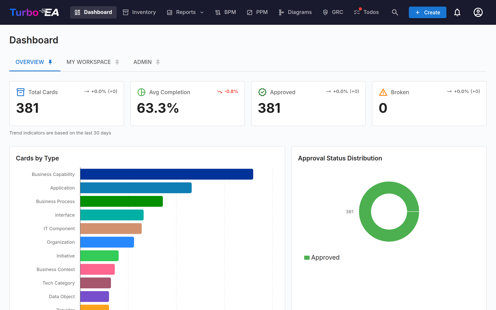
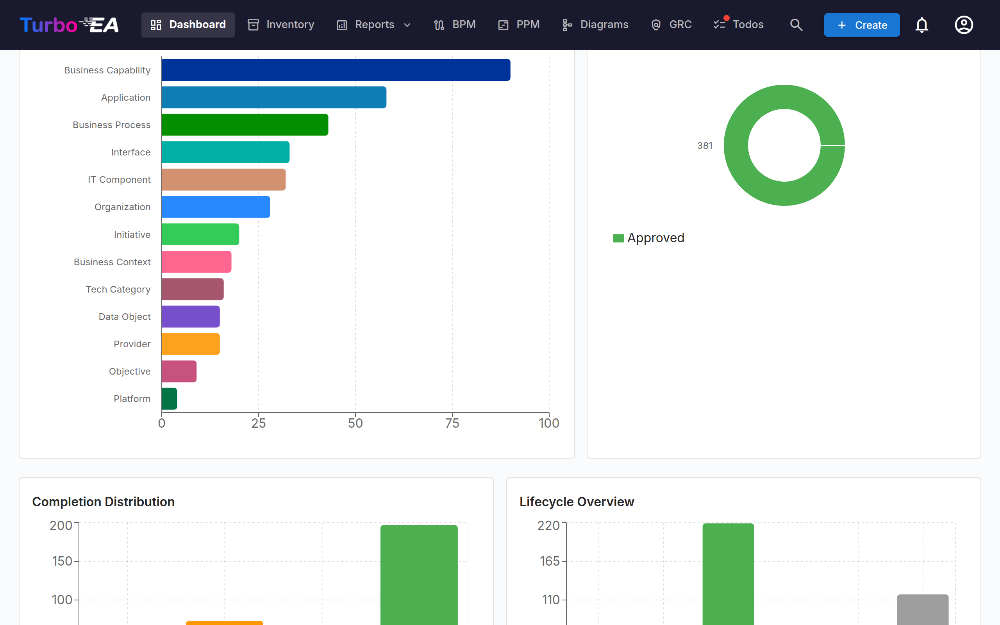

# Dashboard

The Dashboard is the first screen you see after logging in. It provides a **quick overview** of the entire enterprise architecture status.

## Top Navigation Bar

At the top of the screen, you will find the **main navigation bar** with the following elements:

- **Turbo EA** (logo): Click to return to the Dashboard from any section
- **Dashboard**: Overview of the architecture status
- **Inventory**: Complete listing of all cards
- **Reports**: Visual and analytical reports
- **BPM**: Business Process Management (if enabled)
- **Diagrams**: Visual architecture diagram editor
- **EA Delivery**: Architecture initiative management
- **Todos**: Pending tasks and assigned surveys
- **Search cards**: Quick search bar with autocomplete
- **+ Create**: Button to quickly create new cards
- **Notification bell**: System alerts and [notifications](notifications.md)
- **Profile icon**: Language selection, theme toggle, notification preferences, and administration access
- **Sponsor**: A purple-to-pink button next to the version number in the profile menu opens a dialog explaining why sponsorship matters, with a link to the blog and one-time or monthly options via GitHub Sponsors

## Summary Cards

The main section of the Dashboard displays **summary cards** indicating:

- **Total number of cards**: Count of all components registered in the platform
- **Distribution by type**: How many elements of each type exist (Applications, Organizations, Objectives, Capabilities, etc.)
- **Status overview**: Quick visualizations of the overall status

Clicking on a type card navigates to the [Inventory](inventory.md) pre-filtered to that type.

## Charts and Statistics

In the bottom section of the Dashboard you will find:

- **Distribution by type chart**: Shows the proportion of each card type in your landscape
- **Approval status**: Indicates how many cards are approved, pending, broken, or rejected
- **Data quality**: Overall percentage of information completeness across all cards
- **Recent activity**: A feed of the latest changes — who edited what and when

## Executive tab

The **Executive** tab is a one-page summary of delivery, money and risk for senior leadership. It is shown to roles that hold the **`reports.executive_dashboard`** permission — administrators have it automatically; grant it to any other role under **Admin → Users & Roles**. Every figure counts only the cards you are allowed to see, and card types an administrator has hidden are left out of every total.

The tab has six pages: **Overview**, **Strategy**, **Governance**, **Benefits**, **Decisions** and **Details**.

**Overview** is the CEO view: six indicators — strategy achievement, EA governance effectiveness, initiative delivery, services and automation, business value, and decisions and escalations — each on a tile that shows the value, the target, the previous period, the reporting period, how fresh the data is, the owner, a confidence label and a link to the records behind it. A **Reporting period** selector chooses a fiscal year or one of its quarters. The choice is kept in the page address, so a reload or a shared link opens the same period, and it carries across the Executive pages (Details uses its fiscal year); while a new period loads, no figure from the previous one stays on screen. A figure is measured as of the period's last day (or today, for the current period). An indicator whose source or rule has not been decided yet shows **Not available** with the reason, never zero: today that applies to services and automation and realised business value, and to strategy achievement until strategic KPIs have ratified targets and verified measurements. Planned savings appear on the business-value tile as a **Forecast** only. An indicator's target and owner come from the KPI card linked to it (see *KPI cards: performance and target* below); until one is linked they read **No approved target yet** and **Not assigned yet**. A value is judged against a target only once that target is **Ratified** and the KPI's direction is set. Initiative delivery is shown for the current period only, with its **reporting coverage** beside it and a warning when in-flight initiatives have not reported or no report staleness threshold is configured. For a finished period, and for the comparison with the previous period, it shows the period's **verified** value from the KPI measurement history; without one it reads **Historical data unavailable** (or *awaiting verification* when a value was recorded but not yet verified) — no figure is recounted from today's initiatives. These historical values describe the whole landscape, so they are shown only to readers who can see every card. Tiles marked **Current state** — decisions and escalations, and the planned-savings forecast — show today's position whatever period is selected; they are never results for a past period. Other indicators say *No history yet*. The **Executive escalations** panel lists only risks that meet the approved escalation criteria; if you may not open the risk register it shows how many there are rather than an empty panel. On a phone this panel comes first, above the indicators. An indicator that is not available says in plain words what has to be agreed or confirmed before it can be shown.

**Strategy** shows strategy achievement for the current period. A *strategic KPI* is an active KPI card with an approved definition, linked to an active Objective whose type is *strategic*. The headline is **X of Y measured on target** — a KPI is on target when its verified measurement for the period meets its ratified target in the KPI's direction — with coverage (KPIs measured of those linked) beside it. Pillars and strategic objectives list their KPIs with the actual value, the target, the attainment ((actual − baseline) ÷ (target − baseline), from 0 to 100 %, per KPI only) and a state: **On target**, **Below target**, **No verified value**, **Target not ratified**, **Direction not set** or **Definition not approved**. There are no weights and no index, and self-reported objective progress is not used. **Strategy execution** — the delivery health of the initiatives supporting the strategic objectives — is shown separately, because delivery is not evidence that an objective was achieved. A finished period reads *Historical data unavailable*, because the links between objectives and KPIs keep no history.

**Governance** reports EA governance in three sections that are kept strictly apart. **Activity** records what governance happened this period — decisions signed, architecture reviews decided and standard exceptions by their current state — as counts only, with no performance claim; architecture reviews are counted by their latest decision date, and deferred reviews are shown apart and never counted as decisions. **Effectiveness** shows **Technology standards compliance** (the rule-based share of assessed applications and IT components with no un-waived use of a sunset or prohibited standard — an expired waiver counts as a violation) and, beside it as a separate figure, **assessment coverage** (how much of the eligible population was assessed); the two are never combined, and the absence of detected violations is not described as full compliance. If you hold the technology-standards permission, the records behind the compliance gap are listed below the figure. **Governance turnaround (elapsed)** shows, for each instrument separately and never combined, the median and slowest number of calendar days from request to decision: decision records from creation to signature, architecture reviews from scheduling to their first approval or rejection (a deferral is not a decision), and standard exceptions from request to their first approval or rejection. Status changes of decision records, architecture reviews and standard exceptions are recorded from version 2.38.0 onwards; nothing earlier is reconstructed, so a review or exception decided before then is counted as **lifecycle not recorded** rather than timed. Beside each elapsed figure, **time under governance control** leaves out only waits explicitly recorded as due to the requester or an external dependency, with a reason; a deferral or a return to draft caused by governance stays in, and a wait with no recorded reason makes that record untimed (the untimed records are counted by cause). Below each instrument, the same decisions are also shown in **working days** on the business calendar (official Saudi holidays and the working week of each fiscal year); these appear only when every fiscal year of the selected period has a confirmed calendar, and otherwise read **Not available**, naming the years still to confirm. A decision that started in a year without a confirmed calendar is counted apart rather than estimated. **Exception resolution** is the share of exceptions that fell due in the period whose remediation was **verified** on or before the expiry date **granted by the approval in force** — a later change of the expiry date does not move it, and an exception rejected and approved again is measured against the approval whose expiry fell in the period. The figure counts each exception once; below it, **approval cycles** due in the period are counted separately — including earlier approvals later rejected — so those counts can exceed the exception counts and are never added to them. An extension recorded before the expiry passed moves the deadline; one recorded later does not change a past period. A past period is judged by what had happened by its end, so a remediation verified afterwards does not change that period's figure. Remediation verified late, remediation awaiting verification, expired and unresolved exceptions, and the administrative closes — withdrawn, or rejected after approval — are each listed apart and never counted as remediation; exceptions approved before version 2.38.1 are counted as *approved before the history was kept*.

**Decision implementation (GOV-05)** is the share of approved decisions — signed decision records and approved architecture reviews — whose implementation deadline fell due in the period and whose implementation was **independently verified** on or before the **original approved deadline**. Completed actions alone never count. Decisions verified after the deadline, awaiting verification, still in progress, or with no actions (**no plan**) are listed apart, and performance against **revised** deadlines is shown separately. A decision without an approved deadline cannot be timed, so it is outside the rate — but never hidden: the card shows how many approved decisions have no deadline and no actions, and the **planning coverage** (approved decisions with both a deadline and actions, current state). The same figure is the governance tile on the Overview; both show the target of a KPI card linked to GOV-05 and the previous period's verified value. GOV-05 is recorded daily in the KPI measurement history for the current quarter, and each closed period's value is calculated for that period and verified like any other measurement; nothing is recorded for periods before the capture started. No deadline is invented for decisions taken before version 2.40.0. See *Implementing a decision* in the [EA Delivery guide](delivery.md#implementing-a-decision).

**Open architecture-related risks (RSK-01)**, in the Impact section, counts the risks in the risk register that someone has explicitly linked to a decision record, an architecture review or a standard exception. It is a **current-state** figure measured today whatever period is selected — an observed count from recorded governance links, not an inventory of every enterprise risk and not evidence that risk was reduced. No risk is counted because of its category, source or wording. Below it, every linked risk is counted once in the total, open, escalated (the executive escalation rule) and mitigated figures; the breakdown by kind of governance record and the count linked to an approved decision, review or exception overlap — a risk linked to two kinds of record appears under both — and are labelled as not adding up. Links to a record you may not see are left out of every figure. **Verified architecture-risk reduction** stays *Not available*: closing a risk, mitigating it or lowering its residual rating is not shown as reduction. With the risks permission, the architecture-related risks are listed with their linked governance records; records you may not open are counted but not named. RSK-01 can be linked to a KPI card for its target and owner, is recorded daily in the KPI measurement history, and shows the previous period's verified value beside today's count.

**EA review coverage (GOV-01)**, in the Activity section, shows whether initiatives that require EA governance review were reviewed. Whether an initiative requires review is never decided by the system: a holder of the *Assess EA review applicability* permission (no role has it by default) records, for each initiative, that review is **required** or **not required (exempt)**, the approved criteria applied and a justification. Each assessment is kept; a new one replaces the current status without changing earlier ones, and nothing is recorded for earlier dates. An initiative not yet assessed is **undetermined** — never counted as exempt or as compliant. A required review counts as completed only through an **approved architecture review of that initiative**; rejected, deferred or scheduled reviews do not complete it, and signed decision records linked to the initiative are shown as context but never counted. The figure is completed ÷ requiring review, over active initiatives including completed and on-hold ones; requiring review, completed, awaiting (with reviews in progress), exempt, undetermined and the **assessment coverage** are each shown apart. It is a current-state figure; it can be linked to a KPI card for its target and owner, is recorded daily in the KPI measurement history, and shows only the previous period's verified value — nothing is recomputed for the past. With the architecture review or decisions permission, the initiatives are listed with their status, assessment and reviews, and assessors record assessments from that list.

**Governed and ungoverned delivery (GOV-09)**, in the Impact section, shows the initiative-delivery health of in-flight initiatives in four groups: **governed** (review required and completed), **ungoverned** (review required, not completed), **exempt** and **undetermined**. Only governed and ungoverned are compared; exempt and undetermined are shown for context and never treated as ungoverned. Each group uses the same on-track rate and reporting coverage as initiative delivery, and a group's rate — and the difference between the two compared groups — is shown only when at least five of its initiatives reported; the counts are always shown. A difference is an **association, not causation**: it does not show that governance changed delivery. It is a current-state comparison with no history.

**Standard exceptions: lifecycle.** On the Technology Standards page, an approved exception (or one past its expiry) can have **remediation submitted** with evidence by someone holding the standards management permission. Submitting evidence does not resolve it. It is resolved only when someone with the exception approval permission who is neither the requester nor the submitter **verifies** it, and only once the violation itself is gone: verification is refused while the standards check still finds the card using the standard, and where the check cannot assess the card (for example a standard linked to no technology category) the submission must cite evidence from the card including at least one file — a file's content is fingerprinted, so any change after submission blocks the verification, while a link's target cannot be checked — and the verifier must state what they examined and why it shows the violation is resolved, and confirm it; they can instead **return** it with a note, which puts it back to approved. Until it is verified, the waiver stays as it was until its expiry date, which is never extended automatically, and an expired waiver is never treated as resolved. The requester or a standards manager can **withdraw** an exception with a reason at any point before it is rejected, remediated or withdrawn — including after its expiry date or while its remediation awaits verification; withdrawal closes it administratively and the waiver stops covering the card. Changing the expiry date of an approved exception needs a reason and is recorded in its history with the previous and new date. Permanent deletion is reserved for records created in error: it needs the separate *Permanently delete a standard exception* permission (held by no default role), a reason, and is written to the security log; the exception's history is never rewritten or erased. In an exception's history and in the register, the evidence, notes and reasons are shown only to the requester and to people who manage or approve exceptions; others see the status changes, dates and who made them. A standard whose exceptions have been decided can no longer be deleted. When an architecture review is **deferred**, or a decision record goes back to **draft** (on creation, recall or rejection), the person doing it can record whether the wait is due to governance, the requester or an external dependency, with a reason; requester and external delays need the reason. The reason text is visible only to those who manage decision records or reviews, the record's creator, and its signatories or reviewer; others see who the wait was attributed to and when. Compliance reads **Not available** with its reason when no standard governs a category, when you cannot see the applications, IT components or technology categories, or when nothing falls under a governed standard. **Impact** holds governed-versus-ungoverned delivery, architecture risks and the business value of governance; each reads **Not available** with the plain reason it needs, because those depend on later updates. A card you are not allowed to see changes no count on this page. The compliance figure is also captured daily into the KPI measurement history, so a KPI card can be linked to it (see *KPI cards: performance and target* below).

**Benefits** reports benefits realisation for the fiscal year of the selected period, from the [Benefits Register](benefits.md): planned value, actuals reported and awaiting Finance, and value **confirmed by Finance** (cost savings and revenue, cost avoidance, and the realisation rate) are shown as separate figures and never added together; totals are per currency. It also shows Finance's attribution to initiatives, the rationalization run-rate forecast (an annual figure not tied to a fiscal year, never counted as realised), and non-financial outcomes, with KPI-verified and owner-assessed results apart. Return on investment is not calculated yet. The page needs the `benefits.view` permission, and amounts also need `costs.view`. On the Overview, the **business value** indicator shows the Finance-confirmed cost savings and revenue of the period's fiscal year.

**Decisions** shows the current state in two separate groups. **Executive escalations** are open risks that meet the approved rule — rated critical, or high and past their target date (a strategic category alone does not escalate a risk) — with open and mitigated risks counted separately. The **Operational governance pipeline** holds routine governance activity: architecture decision records awaiting signatures, architecture reviews scheduled or deferred, and standard exceptions requested. It is shown for awareness and is not an escalation. Everyone with the Executive tab sees the counts; seeing the records themselves needs that module's own view permission (risks, decision records, architecture reviews, technology standards).

**Details** holds the figures described below.

The header shows when the figures were generated, the date of the latest initiative status report, and a **Reporting period** selector that chooses the fiscal year of the budget figures (the fiscal year follows **Admin → Settings → Fiscal Year Start**).

**Headline figures.** Each tile has an information icon with a plain-language definition, a link to the page behind it, and a label saying where the figure comes from: **Recorded** (counted from records in Turbo EA), **Self-reported** (taken from status reports), **Forecast** (a planned estimate), **Restricted** (you lack the permission) or **Not available** (nothing records it yet). Nothing on the tab is a Finance-verified figure.

- **Initiatives on track**: of the in-flight initiatives that have a current status report, the share whose latest report is on track on schedule, cost and scope (the worst of the three decides).
- **Reporting coverage**: how many in-flight initiatives have a current status report. It is shown separately so that missing reports are never hidden inside the health figure.
- **Budget execution**: actual cost recorded in the selected fiscal year divided by the budget planned for that year.
- **Open critical & high risks**, with the number overdue.
- **Planned savings**: the forecast from rationalization decisions (see below).

**Delivery.** Every in-flight initiative is **On track**, **At risk**, **Off track** or **Unknown / not reported**. An initiative without a status report is *Unknown / not reported* — never counted as healthy and never as at risk. Completed and on-hold initiatives are not in flight and are listed separately. An administrator can set a **staleness threshold** (**Admin → Settings → Initiative report staleness**); reports older than it then also count as not reported. There is no default: until it is set, every existing report counts and the tab says so. When the PPM module is off, each initiative's own **Status** field is used instead of status reports. Budget and actual are for the selected fiscal year only — years are never added together, and a cost line with no date belongs to no year (the tab says how many there are).

**Planned savings.** Savings planned on rationalization decisions (active and completed assessments) are counted **once per application**: if two assessments give the same estimate, it counts once. If they give different estimates, the application is a **conflict**: it is left out of the total until someone reconciles the estimates, and the tab lists it with every estimate. The list names applications and assessments, so it also requires the **`rationalization.view`** permission; without it you see only how many conflicts there are. Planned savings are always a **Forecast**; **Realised savings** are shown separately as *Not available* until verified benefits are recorded. Planned savings are an annual run-rate forecast that is not tied to a fiscal year; they are never counted as realised. A decision already named by a benefit in the [Benefits Register](benefits.md) is left out, so its value is not counted twice.

**Risk exposure** shows open risks by level, and **Processes** shows automation level and maturity, with process documentation coverage (processes with a published flow) as a separate line — documentation is not automation or maturity.

**Repository metrics (specialist)** is a collapsed section with card counts, **data completeness** (the share of weighted fields filled in, not a measure of correctness), **repository review status** (whether cards were reviewed — not architecture compliance), the largest card types and the lifecycle mix, where the end-of-life slice reads **Past planned end-of-life**.

**Money and permissions.** Budget, actual and planned-savings figures require the **`costs.view`** permission; without it they show **Restricted** instead of a number. Amounts are shown in the currency set under **Admin → Settings → Currency**, which is the currency they were recorded in: nothing is converted, and amounts in different currencies are never added together. A section whose module is switched off says so instead of showing zeros.

### KPI cards: performance and target

Every KPI card has a **Performance and target** section on its detail page.

- **Target.** The target value, its date, the baseline, the unit and the direction come from the card's own fields. A target is **Not ratified** until an authorized target approver ratifies it with **Ratify target**. Any later change to the target, its date, the baseline, the unit or the direction makes it unratified again; the earlier ratification stays on record.
- **Measurements.** **Record measurement** stores a value for a fiscal year (`FY2026`) or quarter (`FY2026-Q3`) that has started, with optional evidence. A period has one current value; a different value is entered with **Correct**, which needs a reason and keeps the replaced value as **Superseded**. A new or corrected value is **Awaiting verification** until someone else verifies it — nobody can verify a value they recorded. A verified value of a period that has ended is **Frozen**: it can still be corrected, but only as a new, audited entry. Every measurement event appears on the card's **History** tab.
- **Executive metric link.** The **Executive Metric** field links a KPI card to a calculated executive indicator (initiative delivery, TR-03; executive escalations, DEC-01; technology standards compliance, GOV-03; or decision implementation, GOV-05), so the Overview or Governance tile shows that card's target, ratification state and owner (the card's *Responsible* stakeholders). Only one active KPI card can be linked to each indicator, and setting or changing the link needs the **`admin.metamodel`** permission. A tile whose KPI card you may not see reads as not linked. The same rules apply to KPI cards brought in by a workspace import, a ServiceNow sync or a platform migration: a link that is not a registered indicator, is already held by another active KPI card, or is set by someone without `admin.metamodel` is not applied — the card keeps its previous link (or none), the rest of the record is still imported, and the reason is shown on that record.
- **Permissions.** Recording and correcting need **`kpis.measure`**, verifying needs **`kpis.verify`**, and ratifying needs **`kpis.ratify_targets`** — or **`card.ratify_kpi_target`** on that KPI through a stakeholder role an administrator defines on the KPI card type (for example *KPI target approver*). No default role holds any of these; grant them under **Admin → Users & Roles**. Being a KPI's *Responsible* stakeholder does not allow ratifying its target.
- **Executive indicators.** The daily background job also records the calculated executive indicators. When a fiscal quarter or year ends, the last value observed inside it is submitted as that period's value; it appears in the Overview's previous-period comparison and finished-period figures only once someone holding `kpis.verify` has verified it.

## Workspace tab

The **Workspace** tab pulls together everything assigned to you: favorites, todos, pending surveys, recent activity on your cards, and the **Cards I Have a Role In** section.

That last section groups cards by the stakeholder role you hold (Application Owner, Business Owner, etc.) and lists the cards under each. If your role grants the `stakeholders.view` permission (admin, member and viewer roles by default), a small **person search** icon next to the section title lets you point it at **someone else** — pick a user from the autocomplete and the section refetches and re-renders with that user's roles and cards. The section title flips to "Roles held by {name}". Click the small close icon to return to your own roles. Useful for answering "what does this person own?" in one click.

## Admin tab — Stakeholder directory

Administrators (any role with `admin.users`) get a **Stakeholder directory** widget at the bottom of the Admin tab. It lists every card type that has at least one stakeholder, with the count of distinct holders for each. Expand a card type to see its roles, and inside each role the users who hold it together with the number of cards they cover. Click a user chip to expand its card list inline — each card name is itself a link to the card detail page. The whole tree (card type → role → user → cards) comes back in a single round-trip, so navigation is instant.

A **name filter** at the top of the widget narrows the tree to users matching the typed name or email; matching card types auto-expand so the matches are visible without an extra click. Use it to answer "where does Alice appear in the org?" in one second.

Beyond the directory, a small **hover popover** opens whenever the cursor pauses on a stakeholder name elsewhere in the app — on a card's Stakeholders tab, on a risk owner in the Risk Register, or on the Risk Detail page — and shows that user's full role-grouped stakeholder portfolio. Click any card in the popover to jump to it. The popover fetches once per user per session.
